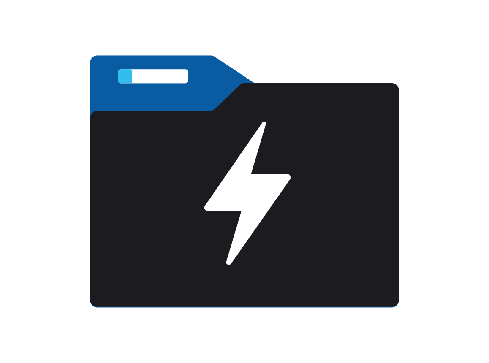

#  Azure Storage Blob Data Lake Sink

**Provided by: "Apache Software Foundation"**

**Support Level for this Kamelet is: "Stable"**

Uploads each message as a file to a file system in Azure Data Lake Storage Gen2, named after the `file` header.

Use it to land data for analytics, such as exports, events or reports, in a data lake. For plain blob containers, use `azure-storage-blob-sink`.

Input: the body is the content of the file: text, bytes or a stream. A Map fails: turn it into JSON text first, for example with `json-serialize-action`. The optional `file` header (or `ce-file`) is the name of the file, such as `sales-2026-05.csv`. Without it, the file gets a generated unique name.

Output: the body afterwards is `true`.

Good to know: by default it logs in as an app registration, with `clientId`, `clientSecret` and `tenantId`, so that app needs a role on the account that allows writing, such as Storage Blob Data Contributor.

## Configuration Options

The following table summarizes the configuration options available for the `azure-storage-datalake-sink` Kamelet:

     
| Property | Name | Description | Type | Default | Example |
| --- | --- | --- | --- | --- | --- |
| **accountName** | Account Name | **Required** The name of the storage account, an Azure Data Lake Storage Gen2 account (a storage account with hierarchical namespace), as shown in the Azure portal under Storage accounts. | string |  | mydatalake |
| **clientId** | Client ID | **Required** The application (client) ID of an app registration (service principal) in Microsoft Entra ID that has access to the account, from the Overview page of the app registration in the Azure portal. Used when `credentialType` is `CLIENT_SECRET`, the default. | string |  |  |
| **clientSecret** | Client Secret | **Required** A client secret of the app registration, from the Azure portal: the app registration, then Certificates & secrets. Used when `credentialType` is `CLIENT_SECRET`, the default. | string |  |  |
| **fileSystemName** | File System Name | **Required** The name of the file system (the container) in the account to write the files to. | string |  | raw-data |
| **tenantId** | Tenant ID | **Required** The directory (tenant) ID of the app registration, from its Overview page in the Azure portal. Used when `credentialType` is `CLIENT_SECRET`, the default. | string |  |  |
| **credentialType** | Credential Type | How to log in to the account. `CLIENT_SECRET`, the default, uses `clientId`, `clientSecret` and `tenantId`. `AZURE_IDENTITY` uses the Azure identity of the environment, such as the `AZURE_CLIENT_ID`, `AZURE_TENANT_ID` and `AZURE_CLIENT_SECRET` environment variables, a managed identity or the Azure CLI login. The other values need a credential object, such as a `DataLakeServiceClient` for `SERVICE_CLIENT_INSTANCE`, in the application. Enum values: \* CLIENT\_SECRET \* SHARED\_KEY\_CREDENTIAL \* AZURE\_IDENTITY \* AZURE\_SAS \* SERVICE\_CLIENT\_INSTANCE | string | CLIENT\_SECRET |  |

## Dependencies

At runtime, the `azure-storage-datalake-sink` Kamelet relies upon the presence of the following dependencies:

-   camel:azure-storage-datalake
    
-   camel:kamelet
    

## Camel JBang usage

### **Prerequisites**

-   You’ve installed [JBang](https://www.jbang.dev/).
    
-   You have executed the following command:
    

```shell
jbang app install camel@apache/camel
```

Supposing you have a file named route.yaml with this content:

```yaml
- route:
    from:
      uri: "kamelet:timer-source"
      parameters:
        period: 10000
        message: 'test'
      steps:
        - to:
            uri: "kamelet:azure-storage-datalake-sink"
```

You can now run it directly through the following command

```shell
camel run route.yaml
```

## Azure Storage Datalake Sink Kamelet Description

### Authentication methods

In this Kamelet, you can use these Azure authentication methods:

-   Client secret: `CLIENT_SECRET` (default)
    
-   Azure SAS: `AZURE_SAS`
    
-   Azure Identity mechanism: `AZURE_IDENTITY`
    
-   Service client instance: `SERVICE_CLIENT_INSTANCE`
    
-   Shared key credentials: `SHARED_KEY_CREDENTIAL`
    

The order of evaluation for `AZURE_IDENTITY` is the following:

-   Enviroment
    
-   Workload Identity
    
-   Managed Identity
    
-   Azure Developer CLI
    
-   IntelliJ
    
-   Azure CLI
    
-   Azure Powershell
    

For more information, see the [Azure Identity documentation](https://learn.microsoft.com/en-us/java/api/overview/azure/identity-readme)

### Optional Headers

In the headers, you can set the `file` / `ce-file` property to specify the filename to upload. If you do not set it, the file gets a generated unique name.

## Kamelet source file

[https://github.com/apache/camel-kamelets/blob/main/kamelets/azure-storage-datalake-sink.kamelet.yaml](https://github.com/apache/camel-kamelets/blob/main/kamelets/azure-storage-datalake-sink.kamelet.yaml)