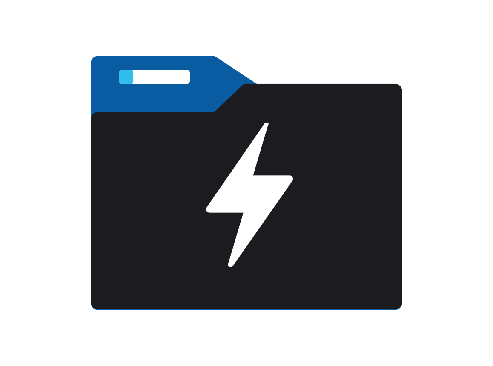

#  Azure Storage Blob Data Lake Source

**Provided by: "Apache Software Foundation"**

**Support Level for this Kamelet is: "Stable"**

Reads the files in a file system of Azure Data Lake Storage Gen2, one message per file, on every poll.

Use it to process files that land in a data lake, such as exports or reports. For plain blob containers, use `azure-storage-blob-source`, which can also delete what it reads.

Output: the body is the content of the file, as a stream of bytes. The `CamelAzureStorageDataLakeFileName` header is the name of the file, and other headers give its size, content type, ETag and last-modified time.

Good to know: it neither deletes nor moves the files, so it reads all of them again on every poll, every 500 milliseconds by default. It reads the files at the top of the file system: files in directories are not read.

## Configuration Options

The following table summarizes the configuration options available for the `azure-storage-datalake-source` Kamelet:

     
| Property | Name | Description | Type | Default | Example |
| --- | --- | --- | --- | --- | --- |
| **accountName** | Account Name | **Required** The name of the storage account, an Azure Data Lake Storage Gen2 account (a storage account with hierarchical namespace), as shown in the Azure portal under Storage accounts. | string |  | mydatalake |
| **clientId** | Client ID | **Required** The application (client) ID of an app registration (service principal) in Microsoft Entra ID that has access to the account, from the Overview page of the app registration in the Azure portal. Used when `credentialType` is `CLIENT_SECRET`, the default. | string |  |  |
| **clientSecret** | Client Secret | **Required** A client secret of the app registration, from the Azure portal: the app registration, then Certificates & secrets. Used when `credentialType` is `CLIENT_SECRET`, the default. | string |  |  |
| **fileSystemName** | File System Name | **Required** The name of the file system (the container) in the account to read the files from. | string |  | raw-data |
| **tenantId** | Tenant ID | **Required** The directory (tenant) ID of the app registration, from its Overview page in the Azure portal. Used when `credentialType` is `CLIENT_SECRET`, the default. | string |  |  |
| **credentialType** | Credential Type | How to log in to the account. `CLIENT_SECRET`, the default, uses `clientId`, `clientSecret` and `tenantId`. `AZURE_IDENTITY` uses the Azure identity of the environment, such as the `AZURE_CLIENT_ID`, `AZURE_TENANT_ID` and `AZURE_CLIENT_SECRET` environment variables, a managed identity or the Azure CLI login. The other values need a credential object, such as a `DataLakeServiceClient` for `SERVICE_CLIENT_INSTANCE`, in the application. Enum values: \* CLIENT\_SECRET \* SHARED\_KEY\_CREDENTIAL \* AZURE\_IDENTITY \* AZURE\_SAS \* SERVICE\_CLIENT\_INSTANCE | string | CLIENT\_SECRET |  |
| **delay** | Delay | How long to wait between two polls of the file system, in milliseconds. | integer | 500 |  |

## Dependencies

At runtime, the `azure-storage-datalake-source` Kamelet relies upon the presence of the following dependencies:

-   camel:azure-storage-datalake
    
-   camel:kamelet
    

## Camel JBang usage

### **Prerequisites**

-   You’ve installed [JBang](https://www.jbang.dev/).
    
-   You have executed the following command:
    

```shell
jbang app install camel@apache/camel
```

Supposing you have a file named route.yaml with this content:

```yaml
- route:
    from:
      uri: "kamelet:azure-storage-datalake-source"
      parameters:
        .
        .
        .
      steps:
        - to:
            uri: "kamelet:log-sink"
```

You can now run it directly through the following command

```shell
camel run route.yaml
```

## Kamelet source file

[https://github.com/apache/camel-kamelets/blob/main/kamelets/azure-storage-datalake-source.kamelet.yaml](https://github.com/apache/camel-kamelets/blob/main/kamelets/azure-storage-datalake-source.kamelet.yaml)