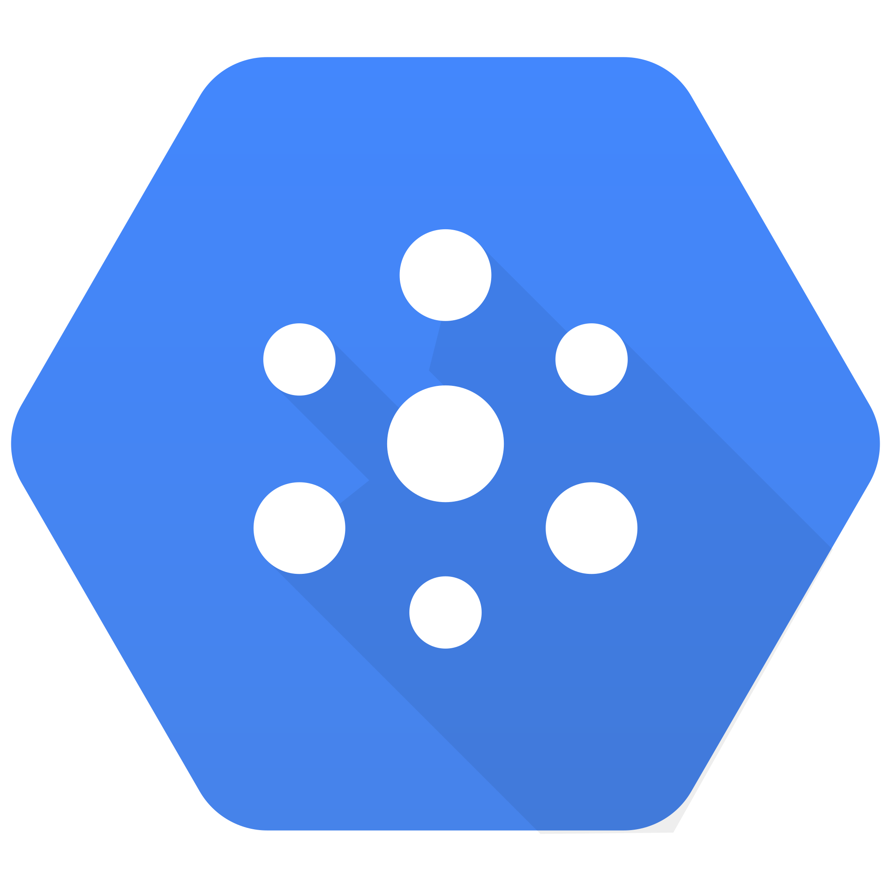

#  Google Pubsub Source

**Provided by: "Apache Software Foundation"**

**Support Level for this Kamelet is: "Stable"**

Receives the messages of a Google Cloud Pub/Sub subscription, one message per Pub/Sub message, and acknowledges each one once it has been processed.

Use it to react to events that other applications publish to a Pub/Sub topic, such as orders, uploads or alerts. To publish messages, use `google-pubsub-sink`. To react to new files in a Cloud Storage bucket through Pub/Sub notifications, use `google-storage-event-based-source`.

Output: the body is the data of the Pub/Sub message, as bytes. The `CamelGooglePubsubMessageId` and `CamelGooglePubsubPublishTime` headers give the ID and the publish time of the message, `CamelGooglePubsubAttributes` gives its attributes as a Map, and each attribute is also set as a header of its own.

Good to know: the subscription must already exist; for one that does not, it logs an error and receives nothing. A message whose processing fails is not acknowledged, so Pub/Sub delivers it again. Without `serviceAccountKey`, it logs in with the Application Default Credentials of the environment where it runs.

## Configuration Options

The following table summarizes the configuration options available for the `google-pubsub-source` Kamelet:

     
| Property | Name | Description | Type | Default | Example |
| --- | --- | --- | --- | --- | --- |
| **projectId** | Project ID | **Required** The ID of the Google Cloud project that holds the subscription, as shown in the Google Cloud console. It is the project ID, not the project name or number. | string |  | my-project-123 |
| **subscriptionName** | Subscription Name | **Required** The name of the subscription to read from, without the `projects/…​/subscriptions/` part. Create it on the topic first, in the Google Cloud console or with `gcloud pubsub subscriptions create`. | string |  | orders-sub |
| **concurrentConsumers** | Concurrent Consumers | How many messages to receive and process in parallel, each in its own stream from the subscription. | integer | 1 |  |
| **maxMessagesPerPoll** | Max Messages Per Poll | The most messages to ask Pub/Sub for at once. Only used when `synchronousPull` is true. | integer | 1 |  |
| **serviceAccountKey** | Service Account Key | The JSON key of a service account that may read the subscription, encoded in Base64: create the key in the Google Cloud console under IAM & Admin > Service Accounts > Keys, then encode the downloaded file, for example with `base64 -w0 key.json`. When it is not set, the Application Default Credentials are used: the key file named in the `GOOGLE_APPLICATION_CREDENTIALS` environment variable, or the service account of the Google Cloud machine it runs on. | binary |  |  |
| **synchronousPull** | Synchronous Pull | If true, it asks Pub/Sub for messages in batches of up to `maxMessagesPerPoll`, instead of keeping a stream open that Pub/Sub pushes the messages through. | boolean | false |  |

## Dependencies

At runtime, the `google-pubsub-source` Kamelet relies upon the presence of the following dependencies:

-   camel:kamelet
    
-   camel:google-pubsub
    
-   camel:jackson3
    

## Camel JBang usage

### **Prerequisites**

-   You’ve installed [JBang](https://www.jbang.dev/).
    
-   You have executed the following command:
    

```shell
jbang app install camel@apache/camel
```

Supposing you have a file named route.yaml with this content:

```yaml
- route:
    from:
      uri: "kamelet:google-pubsub-source"
      parameters:
        .
        .
        .
      steps:
        - to:
            uri: "kamelet:log-sink"
```

You can now run it directly through the following command

```shell
camel run route.yaml
```

## Google Pubsub Source Kamelet Description

### Authentication methods

This Kamelet uses Service Account Key authentication to connect to Google Cloud Pub/Sub. You need to provide:

-   A service account key encoded in base64 format
    
-   The Google Cloud Project ID
    
-   The subscription name from which to consume messages
    

### Output format

The Kamelet consumes messages from Google Cloud Pub/Sub. The body is the data of each message, as bytes, and the attributes of the message are set as headers.

### Configuration

The Kamelet requires the following parameters:

-   `projectId`: The Google Cloud Pub/Sub Project ID
    
-   `subscriptionName`: The subscription name
    

Optional parameters: - `serviceAccountKey`: The service account key to use as credentials (must be base64 encoded) - `synchronousPull`: Specifies to synchronously pull batches of messages (default: false) - `maxMessagesPerPoll`: The maximum number of messages to receive from the server in a single API call (default: 1) - `concurrentConsumers`: The number of parallel streams to consume from the subscription (default: 1)

### Usage example

```yaml
apiVersion: camel.apache.org/v1alpha1
kind: KameletBinding
metadata:
  name: google-pubsub-source-binding
spec:
  source:
    ref:
      kind: Kamelet
      apiVersion: camel.apache.org/v1alpha1
      name: google-pubsub-source
    properties:
      projectId: "my-gcp-project"
      subscriptionName: "my-subscription"
      serviceAccountKey: "{{service-account-key-base64}}"
      synchronousPull: true
      maxMessagesPerPoll: 10
      concurrentConsumers: 2
  sink:
    ref:
      kind: Service
      apiVersion: v1
      name: my-service
```

## Kamelet source file

[https://github.com/apache/camel-kamelets/blob/main/kamelets/google-pubsub-source.kamelet.yaml](https://github.com/apache/camel-kamelets/blob/main/kamelets/google-pubsub-source.kamelet.yaml)