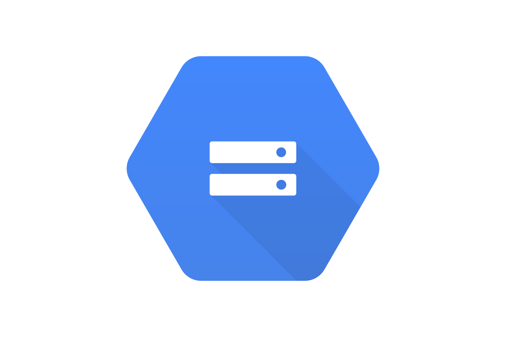

#  Google Storage Sink

**Provided by: "Apache Software Foundation"**

**Support Level for this Kamelet is: "Stable"**

Uploads each message as a file (object) to a Google Cloud Storage bucket.

Use it to store data for later use or for other systems, such as exported reports, archived events or files received from another system. To read the files of a bucket, use `google-storage-source`.

Input: the body is the content of the file, as text, bytes, a stream or a file. Text is turned into bytes before the upload, and the `Content-Type` header is set to `application/octet-stream`. A file is passed on as it is, and so is a stream, unless stream caching is turned off. Turn structured data such as a Map into JSON text first, for example with `json-serialize-action`. The optional `file` header (or `ce-file`) is the name of the file in the bucket, with its folders, such as `reports/2024-06-01.csv`; without it, the file gets a generated unique name.

Output: when it is used inside a route, the body afterwards describes the uploaded file (its bucket, name, size and generation), not its content, the `Content-Type` header is `application/octet-stream`, and the `CamelGoogleCloudStorageObjectName` header holds the name of the file.

Good to know: a file with the same name is overwritten. With `objectName`, every message overwrites the same file. The bucket must exist, unless `autoCreateBucket` is true; a bucket it creates is in `storageLocation`, `US-EAST1` when that is not set. Without `serviceAccountKey`, it logs in with the Application Default Credentials of the environment where it runs, or with Workload Identity Federation when `useWorkloadIdentityFederation` is true. Headers that start with `CamelGoogleCloudStorage` are removed from the message first, so they cannot change what the Kamelet does.

## Configuration Options

The following table summarizes the configuration options available for the `google-storage-sink` Kamelet:

     
| Property | Name | Description | Type | Default | Example |
| --- | --- | --- | --- | --- | --- |
| **bucketNameOrArn** | Bucket Name | **Required** The name of the bucket to upload the files to, without `gs://`. | string |  | my-bucket |
| **autoCreateBucket** | Autocreate Bucket | If true, the bucket is created when it does not exist yet. The service account then needs the permission to create buckets in the project. | boolean | false |  |
| **impersonatedServiceAccount** | Impersonated Service Account | The email of a service account to act as, with the credentials of Workload Identity Federation, so that the Kamelet gets the permissions of that service account. The federated identity needs the Service Account Token Creator role on it. Only used when `useWorkloadIdentityFederation` is true. | string |  | storage-writer@my-project-123.iam.gserviceaccount.com// |
| **objectName** | Object Name | The name of the file in the bucket, with its folders, such as `status/latest.json`. When it is set, every message is written to that file, whatever the `file` and `ce-file` headers say. | string |  | status/latest.json |
| **serviceAccountKey** | Service Account Key | The JSON key of a service account that may write to the bucket, encoded in Base64: create the key in the Google Cloud console under IAM & Admin > Service Accounts > Keys, then encode the downloaded file, for example with `base64 -w0 key.json`. When it is not set, the Application Default Credentials are used: the key file named in the `GOOGLE_APPLICATION_CREDENTIALS` environment variable, or the service account of the Google Cloud machine it runs on. | binary |  |  |
| **storageClass** | Storage Class | The storage class of the uploaded files, which sets what storing and reading them costs: `STANDARD`, `NEARLINE` (for files read about once a month), `COLDLINE` (once a quarter) or `ARCHIVE` (once a year). When it is not set, a file gets the default storage class of the bucket. Enum values: \* STANDARD \* NEARLINE \* COLDLINE \* ARCHIVE | string |  | NEARLINE |
| **storageLocation** | Storage Location | The location of the bucket that `autoCreateBucket` creates, such as a region (`europe-west1`) or a multi-region (`EU`). Only used when the bucket is created. When it is not set, it is `US-EAST1`. | string |  | EU |
| **useWorkloadIdentityFederation** | Use Workload Identity Federation | If true, it logs in with Workload Identity Federation instead of `serviceAccountKey`, which is then ignored. It uses the credential configuration file in `workloadIdentityConfig` or, when that is not set, the Application Default Credentials. When it is not set, it is false. | boolean |  |  |
| **workloadIdentityConfig** | Workload Identity Configuration | Where to load the Workload Identity Federation credential configuration file from: the JSON file of type `external_account` that `gcloud iam workload-identity-pools create-cred-config` creates, which tells how to exchange a token of another identity provider, such as AWS, Azure or Kubernetes, for Google credentials. Prefix the path with `file:`, `classpath:`, `http:` or `https:`. Only used when `useWorkloadIdentityFederation` is true. | string |  | file:/var/run/secrets/gcp/credential-config.json |

## Dependencies

At runtime, the `google-storage-sink` Kamelet relies upon the presence of the following dependencies:

-   camel:kamelet
    
-   camel:google-storage
    
-   camel:jackson3
    

## Camel JBang usage

### **Prerequisites**

-   You’ve installed [JBang](https://www.jbang.dev/).
    
-   You have executed the following command:
    

```shell
jbang app install camel@apache/camel
```

Supposing you have a file named route.yaml with this content:

```yaml
- route:
    from:
      uri: "kamelet:timer-source"
      parameters:
        period: 10000
        message: 'test'
      steps:
        - to:
            uri: "kamelet:google-storage-sink"
```

You can now run it directly through the following command

```shell
camel run route.yaml
```

## Google Storage Sink Kamelet Description

### Authentication

This Kamelet supports Google Cloud service account authentication. The service account key is optional - if not provided, the Kamelet will use default credentials.

### Required Configuration

-   **Bucket Name**: The name of the Google Cloud Storage bucket
    

### Optional Configuration

-   **Service Account Key**: The JSON key file of a service account, encoded in Base64
    
-   **Auto Create Bucket**: Automatically creates the bucket if it doesn’t exist (defaults to false)
    
-   **Storage Location**: The location of the bucket that Auto Create Bucket creates (when not set: `US-EAST1`)
    
-   **Object Name**: A fixed name of the object, for every message
    
-   **Workload Identity Federation**: `useWorkloadIdentityFederation`, `workloadIdentityConfig` and `impersonatedServiceAccount`, as described for the Google Storage Source Kamelet
    

### Optional Headers

In the header, you can optionally set the `file` / `ce-file` property to specify the name of the object to upload.

If you do not set the property in the header, the Kamelet uses a generated unique name for the object. An object with the same name is overwritten.

### A Fixed Object Name

With `objectName`, every message is written to the same object, whatever the `file` and `ce-file` headers say. For example, to keep the latest status in one file:

```yaml
- route:
    from:
      uri: "kamelet:timer-source"
      parameters:
        period: 60000
        message: '{"status": "ok"}'
      steps:
        - to:
            uri: "kamelet:google-storage-sink"
            parameters:
              bucketNameOrArn: "my-bucket"
              objectName: "status/latest.json"
```

### Creating the Bucket

With `autoCreateBucket: true`, a bucket that does not exist is created when the Kamelet starts, in `storageLocation`, such as a region (`europe-west1`) or a multi-region (`EU`). When `storageLocation` is not set, the bucket is created in `US-EAST1`. A bucket that exists is used as it is.

```yaml
- to:
    uri: "kamelet:google-storage-sink"
    parameters:
      bucketNameOrArn: "my-bucket"
      autoCreateBucket: true
      storageLocation: "EU"
```

## Kamelet source file

[https://github.com/apache/camel-kamelets/blob/main/kamelets/google-storage-sink.kamelet.yaml](https://github.com/apache/camel-kamelets/blob/main/kamelets/google-storage-sink.kamelet.yaml)