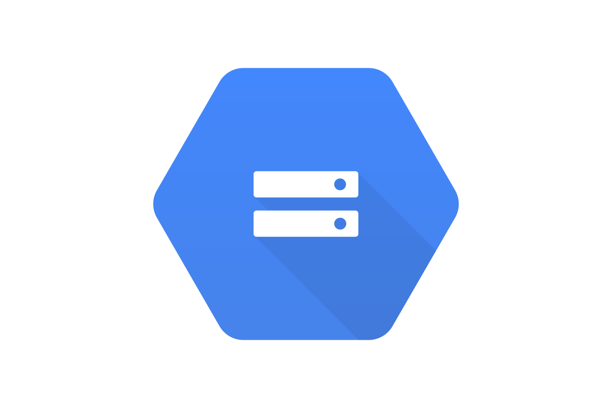

#  Google Storage Source

**Provided by: "Apache Software Foundation"**

**Support Level for this Kamelet is: "Stable"**

Reads the files (objects) in a Google Cloud Storage bucket, one message per file, and by default deletes each file once it has been read.

Use it to process files that another system drops into a bucket, such as uploaded documents, exported reports or log files. To react to new files through Pub/Sub notifications instead of reading the bucket over and over, use `google-storage-event-based-source`.

Output: the body is the content of the file, as a stream. The headers give the bucket name (`CamelGoogleCloudStorageBucketName`), the object name, that is the path of the file in the bucket (`CamelGoogleCloudStorageObjectName`), the content type and the ETag of the file.

Good to know: files are deleted from the bucket after they are read, unless `deleteAfterRead` is set to false; then the same files are read again on every poll, about twice a second. A file whose processing fails is not deleted, and is read again on the next poll. Without `serviceAccountKey`, it logs in with the Application Default Credentials of the environment where it runs.

## Configuration Options

The following table summarizes the configuration options available for the `google-storage-source` Kamelet:

     
| Property | Name | Description | Type | Default | Example |
| --- | --- | --- | --- | --- | --- |
| **bucketNameOrArn** | Bucket Name | **Required** The name of the bucket to read the files from, without `gs://`. | string |  | my-bucket |
| **autoCreateBucket** | Autocreate Bucket | If true, the bucket is created when it does not exist yet. | boolean | false |  |
| **deleteAfterRead** | Auto-delete Objects | If true, each file is deleted from the bucket after it has been read. Set it to false to keep the files; they are then read again on every poll. | boolean | true |  |
| **filter** | Filter | A regular expression that the whole name of a file must match for the file to be read, such as `.*\.csv` for the CSV files only. The name includes the folders, as in `inbox/orders.csv`. | string |  | .\*\\.csv |
| **prefix** | Prefix | Only read the files whose name starts with this text, such as a folder followed by `/`. | string |  | inbox/ |
| **serviceAccountKey** | Service Account Key | The JSON key of a service account that may read (and delete) the files of the bucket, encoded in Base64: create the key in the Google Cloud console under IAM & Admin > Service Accounts > Keys, then encode the downloaded file, for example with `base64 -w0 key.json`. When it is not set, the Application Default Credentials are used: the key file named in the `GOOGLE_APPLICATION_CREDENTIALS` environment variable, or the service account of the Google Cloud machine it runs on. | binary |  |  |

## Dependencies

At runtime, the `google-storage-source` Kamelet relies upon the presence of the following dependencies:

-   camel:kamelet
    
-   camel:google-storage
    
-   camel:jackson
    

## Camel JBang usage

### **Prerequisites**

-   You’ve installed [JBang](https://www.jbang.dev/).
    
-   You have executed the following command:
    

```shell
jbang app install camel@apache/camel
```

Supposing you have a file named route.yaml with this content:

```yaml
- route:
    from:
      uri: "kamelet:google-storage-source"
      parameters:
        .
        .
        .
      steps:
        - to:
            uri: "kamelet:log-sink"
```

You can now run it directly through the following command

```shell
camel run route.yaml
```

## Google Storage Source Kamelet Description

### Authentication methods

This Kamelet uses Service Account Key authentication to connect to Google Cloud Storage. You need to provide:

-   A service account key encoded in base64 format (optional, can use default credentials)
    
-   The name of the bucket from which to consume objects
    

### Output format

The Kamelet consumes objects from Google Cloud Storage and produces the object data.

### Configuration

The Kamelet requires the following parameters:

-   `bucketNameOrArn`: The name of the Google Cloud Storage bucket
    

Optional parameters: - `serviceAccountKey`: The service account key to use as credentials (must be base64 encoded) - `deleteAfterRead`: Specifies to delete objects after consuming them (default: true) - `autoCreateBucket`: Specifies to automatically create the Google Cloud Storage bucket (default: false) - `prefix`: The prefix which is used in the BlobListOptions to only consume objects we are interested in

### Usage example

```yaml
apiVersion: camel.apache.org/v1alpha1
kind: KameletBinding
metadata:
  name: google-storage-source-binding
spec:
  source:
    ref:
      kind: Kamelet
      apiVersion: camel.apache.org/v1alpha1
      name: google-storage-source
    properties:
      bucketNameOrArn: "my-storage-bucket"
      serviceAccountKey: "{{service-account-key-base64}}"
      deleteAfterRead: false
      autoCreateBucket: false
      prefix: "data/"
  sink:
    ref:
      kind: Service
      apiVersion: v1
      name: my-service
```

## Kamelet source file

[https://github.com/apache/camel-kamelets/blob/main/kamelets/google-storage-source.kamelet.yaml](https://github.com/apache/camel-kamelets/blob/main/kamelets/google-storage-source.kamelet.yaml)