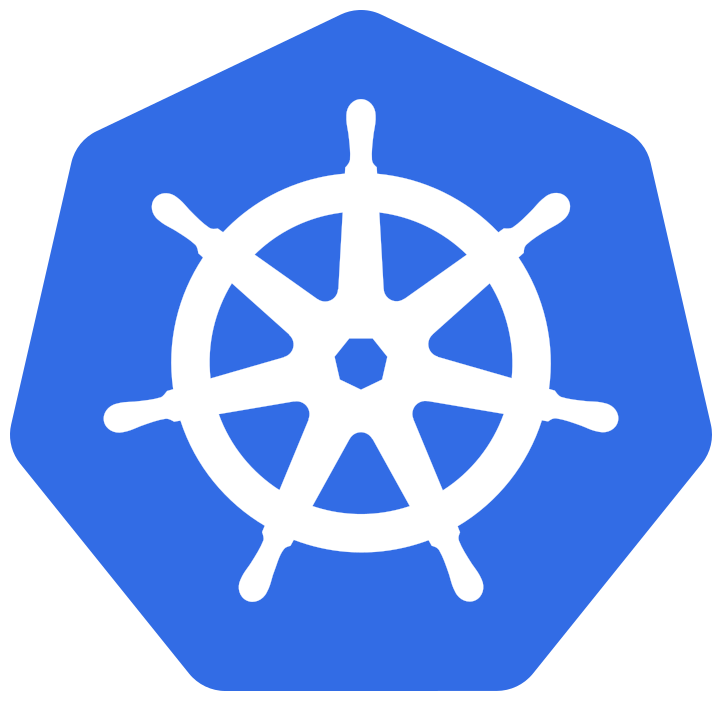

#  Kubernetes Pods Source

**Provided by: "Apache Software Foundation"**

**Support Level for this Kamelet is: "Stable"**

Watches the pods of a Kubernetes cluster and sends a message each time a pod is added, changed or deleted, in any namespace.

Use it to react to what happens to workloads, for example to alert when a pod fails or restarts, or to keep an inventory of running pods. For nodes or namespaces, use `kubernetes-nodes-source` or `kubernetes-namespaces-source`.

Output: the body is the pod as JSON text, in the same shape as `kubectl get pod <name> -o json`. The `CamelKubernetesEventAction` header says what happened: `ADDED`, `MODIFIED` or `DELETED`.

Good to know: when it starts, it first sends an `ADDED` message for every pod that already exists. A pod changes often, so expect many `MODIFIED` messages. It watches the pods of all namespaces: `resourceName` has no effect. The token must be allowed to list and watch pods in all namespaces.

## Configuration Options

The following table summarizes the configuration options available for the `kubernetes-pods-source` Kamelet:

     
| Property | Name | Description | Type | Default | Example |
| --- | --- | --- | --- | --- | --- |
| **masterUrl** | Kubernetes Master URL | **Required** The address of the Kubernetes API server, as a URL that starts with `https://`, such as the `server` of the cluster in your kubeconfig file. | string |  | https://my-cluster.example.com:6443 |
| **token** | Token | **Required** A bearer token to log in to the Kubernetes API with, such as the token of a service account created with `kubectl create token <service-account>`. | string |  |  |
| **resourceName** | Resource Name | Meant to watch only the pod with this name, but it has no effect, as this Kamelet watches the pods of all namespaces. | string |  | web-1 |

## Dependencies

At runtime, the `kubernetes-pods-source` Kamelet relies upon the presence of the following dependencies:

-   camel:kubernetes
    
-   camel:kamelet
    
-   camel:jackson
    

## Camel JBang usage

### **Prerequisites**

-   You’ve installed [JBang](https://www.jbang.dev/).
    
-   You have executed the following command:
    

```shell
jbang app install camel@apache/camel
```

Supposing you have a file named route.yaml with this content:

```yaml
- route:
    from:
      uri: "kamelet:kubernetes-pods-source"
      parameters:
        .
        .
        .
      steps:
        - to:
            uri: "kamelet:log-sink"
```

You can now run it directly through the following command

```shell
camel run route.yaml
```

## Kubernetes-pods-source Kamelet Description

### Authentication methods

This Kamelet connects to the Kubernetes API server given by `masterUrl` with a bearer token, the `token` option, such as the token of a service account created with `kubectl create token <service-account>`. The token must be allowed to list and watch pods.

### Output format

The Kamelet watches Kubernetes pods resources and produces a message when one is created, updated, or deleted. The body is the resource as JSON text, and the `CamelKubernetesEventAction` header says what happened (`ADDED`, `MODIFIED` or `DELETED`).

### Configuration

The Kamelet requires `masterUrl` and `token`. It watches the pods of all namespaces: it has no option to choose a namespace, and `resourceName` has no effect.

### Usage example

```yaml
apiVersion: camel.apache.org/v1alpha1
kind: KameletBinding
metadata:
  name: kubernetes-pods-source-binding
spec:
  source:
    ref:
      kind: Kamelet
      apiVersion: camel.apache.org/v1alpha1
      name: kubernetes-pods-source
    properties:
      masterUrl: "https://my-cluster.example.com:6443"
      token: "{{kubernetes-token}}"
  sink:
    ref:
      kind: Service
      apiVersion: v1
      name: my-service
```

## Kamelet source file

[https://github.com/apache/camel-kamelets/blob/main/kamelets/kubernetes-pods-source.kamelet.yaml](https://github.com/apache/camel-kamelets/blob/main/kamelets/kubernetes-pods-source.kamelet.yaml)