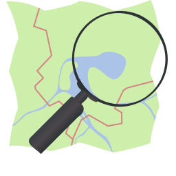

#  Nominatim GeoCode Action

**Provided by: "Apache Software Foundation"**

**Support Level for this Kamelet is: "Stable"**

Looks up a place name or a postal address, such as `Eiffel Tower, Paris`, in a Nominatim server of OpenStreetMap, and gives the best match with its coordinates as JSON.

Use it to turn the addresses in orders, customer records or events into latitude and longitude, for example to show them on a map or to find the nearest store.

Input: the place name or address to look up, as text.

Output: the body is JSON text, as bytes, with `Content-Type: application/json`: an array with the best match, with its coordinates, its full address and its kind of place, or an empty array when nothing matches. The headers give the same answer in short: `CamelGeoCoderLat` and `CamelGeoCoderLng` (the coordinates), `CamelGeoCoderAddress` (the full address found), `CamelGeoCoderCity`, `CamelGeoCoderCountryLong`, `CamelGeoCoderPostalCode` and `CamelGeoCoderStatus`, which is `OK` when a place was found and `ZERO_RESULTS` when none was.

Good to know: a place that is not found does not fail the message; check `CamelGeoCoderStatus`. The public server `[https://nominatim.openstreetmap.org](https://nominatim.openstreetmap.org)` limits how often it may be called; for many lookups, run your own Nominatim server. Headers that start with `CamelGeoCoder` are removed from the message first, so they cannot change what the Kamelet does.

## Configuration Options

The following table summarizes the configuration options available for the `nominatim-geocode-action` Kamelet:

     
| Property | Name | Description | Type | Default | Example |
| --- | --- | --- | --- | --- | --- |
| **serverUrl** | Server URL | **Required** The address of the Nominatim server, starting with `https://`, without a path. Use the public OpenStreetMap server for a few lookups, or your own server. | string |  | https://nominatim.openstreetmap.org |

## Dependencies

At runtime, the `nominatim-geocode-action` Kamelet relies upon the presence of the following dependencies:

-   camel:jackson3
    
-   camel:geocoder
    
-   camel:kamelet
    

## Camel JBang usage

### **Prerequisites**

-   You’ve installed [JBang](https://www.jbang.dev/).
    
-   You have executed the following command:
    

```shell
jbang app install camel@apache/camel
```

Supposing you have a file named route.yaml with this content:

```yaml
- route:
    from:
      uri: "kamelet:timer-source"
      parameters:
        period: 10000
        message: 'test'
      steps:
        - to:
            uri: "kamelet:nominatim-geocode-action"
            parameters:
            .
            .
            .
        - to:
            uri: "kamelet:log-sink"
```

You can now run it directly through the following command

```shell
camel run route.yaml
```

## Kamelet source file

[https://github.com/apache/camel-kamelets/blob/main/kamelets/nominatim-geocode-action.kamelet.yaml](https://github.com/apache/camel-kamelets/blob/main/kamelets/nominatim-geocode-action.kamelet.yaml)