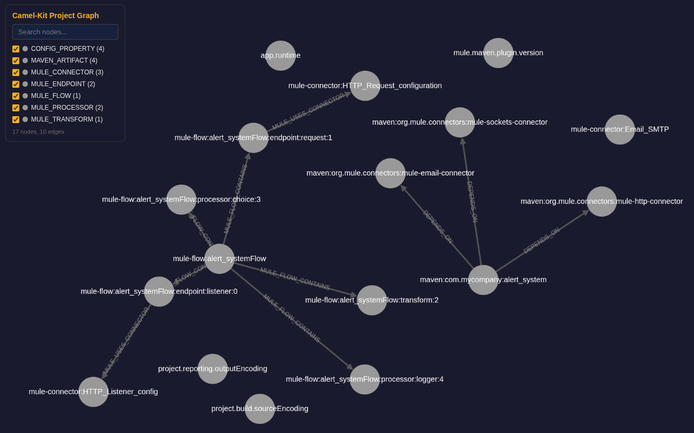

# Graph intelligence

Camel Kit can build a property graph of an integration project: nodes for classes, routes, endpoints, beans, Maven artifacts and configuration properties, edges for inheritance, injection, route flow, bean references and configuration bindings. The graph feeds migration analysis, impact analysis, project-aware validation and retirement-candidate reporting. It is optional: every skill works without it, uses it when it is available, and skips the graph-enhanced steps silently when the CLI is unavailable. The graph enhances the agent; it never gates it.



## How the graph is built

`camel-kit graph generate` runs nine content parsers and two post-processors and persists the result at `.camel-kit/project-graph.json` (another path with `--output`; queries take `--graph-file`). `PomParser` runs first and synchronously, because the other parsers need the Maven artifacts for runtime detection and for the dependency allowlist; the eight others then run in parallel on parser-local fragments that are merged in a fixed order, so the result does not depend on completion timing. Parser diagnostics record the scanned files, warnings, failures, timeouts and produced counts.

  
| Parser | Purpose | Files |
| --- | --- | --- |
| `PomParser` | Maven dependencies and properties, runtime detection | `pom.xml` |
| `JavaGraphParser` | Classes, methods, fields, DI annotations, Java DSL routes | `*.java` |
| `GroovyGraphParser` | Groovy scripts and classes | `*.groovy` |
| `XmlRouteParser` | Camel XML routes, recognized by the `route` element in any namespace | `*.xml` except POM, Mule and BizTalk inputs |
| `YamlRouteParser` | Camel YAML DSL routes | `*.yaml`, `*.yml` except `application*` |
| `ConfigParser` | Every application property, not only the `camel.*` keys | `application.properties`, `application-*.properties` |
| `MuleXmlFlowParser` | Mule 3.x and 4.x flows, sub-flows, connectors, endpoints, transforms, error handlers | `*.xml` with the Mule namespace |
| `DataWeaveParser` | DataWeave version, content types, functions, field access patterns | `*.dwl` |
| `BizTalkParser` | Orchestrations, maps, pipelines and bindings, through four StAX sub-parsers | `.odx`, `.btm`, `.btp`, binding `.xml` |

The post-processors run on the assembled graph: `CrossLinker` links producer and consumer routes through `direct` and `seda` endpoints, maps component usage to Maven artifacts, binds configuration to endpoints and creates the interface shortcuts described below; `PropertyBindingParser` then reads the property values for Camel’s `PropertyBindingSupport` syntax. Mule and BizTalk files are detected by their namespaces and extensions, so no configuration is needed; `init --source-platform` only hints the platform for unusual layouts. `camel-kit graph visualize` writes an interactive page to `.camel-kit/project-graph.html`.

## Commands

 
| Command | Purpose |
| --- | --- |
| **Analysis** |
| `stats` | `available`, node and edge totals, nodes by type |
| `find` | Nodes by type, with a regular expression on the name or fully qualified name, falling back to the node ID |
| `neighbors` | Incoming, outgoing or both directions, optionally filtered by edge type and depth |
| `path` | The shortest path between two nodes |
| `subgraph` | The subgraph around a node, by breadth-first search with a depth limit |
| **Camel-specific** |
| `route-flow` | The ordered `FROM`, `PROCESSOR` and `TO` steps of an exact `CAMEL_ROUTE` node, or of the route consuming a given endpoint with `--from-endpoint` |
| `impact` | Bounded transitive reachability, up to 50 nodes per direction; `--direction upstream`, `downstream` or `both` (the default) |
| `route-topology` | Route-to-route connections with the target route, endpoint scheme and URI |
| `dead-code` | Structural retirement candidates: non-framework `camel-*` artifacts with no component usage, `direct` and `seda` consumers no route produces for, `camel.*` properties that configure nothing |
| **Context** |
| `project-norms` | Route ID naming, error-handling coverage, property prefixes and route step-count norms, including the observed P75 |
| `project-context` | Property conventions, existing beans, dependency versions and the route directory |
| `route-context` | Upstream, downstream, classified endpoints and the error flow of a route |
| `migration-context` | Bounded bidirectional context around a route for migration, see below |
| **Output** |
| `generate` | Build or rebuild the graph from the sources |
| `visualize` | Render the interactive HTML visualization |

Every result is a candidate within the graph’s coverage, not proof: a `dead-code` entry means the graph found no path, not that the code is safe to remove. Regenerate the graph after source changes so queries reflect the current project.

## Dependency-injection-aware analysis

`JavaGraphParser` understands injection across frameworks. Every field and constructor parameter of an allowed type creates a `USES_TYPE` edge, and `@Inject` or `@Autowired` marks that edge as an injection; `@Component`, `@Service`, `@Repository`, `@Controller`, `@Named`, `@Singleton`, `@ApplicationScoped` and `@RequestScoped` mark managed beans; `@Value` and `@ConfigProperty` create `INJECTS_INTO` edges from configuration properties to the fields that consume them. A POM-driven scope guard keeps the graph focused: `USES_TYPE` edges are created only for project-local classes, Apache Camel types and the framework types (Spring, Quarkus, Mule) found in the Maven dependencies, never for JDK types.

When class A injects interface I and class C implements I, `CrossLinker` adds a `DEPENDS_ON_VIA_INTERFACE` shortcut from A to C, and the traversal used by `impact` and `migration-context` crosses it. Without it, an upstream impact query on `OrderServiceImpl` returns nothing, because the route class only knows the `OrderService` interface; with it, the query returns the consumer classes, `OrderRoute` among them. `impact` follows incoming edges only, so the route’s endpoints are not part of that result: `route-context` or `migration-context` on the route shows its `kafka` source and `direct:payment` target.

`PropertyBindingParser` turns `application.properties` into part of the graph: `#class:` creates `INSTANTIATES` edges, `#bean:`, `#autowired` and `#type:` create `REFERENCES_BEAN` edges, `#property:` creates `REFERENCES_PROPERTY` edges, and placeholders in endpoint URIs create `CONFIGURES` edges to the matching properties. Spring Boot and Quarkus data source conventions become synthetic bean nodes, and Quarkus build-time properties are marked as such. A shared `RuntimeDetector` identifies Spring Boot, Quarkus, Camel Main or Karaf from the Maven dependencies; `init` persists the result in `.camel-kit/config.properties`.

## Migration context

```bash
camel-kit graph migration-context <routeId> [--depth N]
```

The command performs a bidirectional, interface-aware breadth-first search from one route (the ID without the `route:` prefix), with depth 3 by default and at most 50 expanded nodes, and returns structured JSON: the reached `routes` with their source endpoint and file, the deduplicated `components`, the `services` (bean class and name), the Maven `artifacts`, the `properties` with their outgoing edge type and target, and `warnings` for every reached node that was inferred rather than parsed. `runtime` comes from the project configuration. The result is focused local context, not a complete dependency map, and the command makes no MCP call: documentation, CVE or compatibility lookups are separate actions through the Knowledge server, using the reported components as input. See [Graph analysis](migration.html#graph) for how the migration uses it.

## Background

The interface-consumer expansion and the bidirectional traversal follow the deterministic knowledge base approach of Chinthareddy, [Reliable Graph-RAG for Codebases: AST-Derived Graphs vs LLM-Extracted Knowledge Graphs](https://arxiv.org/abs/2601.08773) (2026), which found deterministic AST-derived graphs both more correct and far cheaper than model-extracted knowledge graphs for multi-hop questions on Java codebases. Camel Kit departs from the paper where Camel projects differ from self-contained applications: it parses with JavaParser rather than Tree-sitter, tracks framework types from the POM instead of project-local types only, models the Maven dependency layer and the component-to-artifact mapping, and treats property-based bean wiring and configuration-to-code links as part of the architecture.

## Where the graph is used

-   `/camel-migrate` corroborates and accelerates its source analysis with the graph when one is current.
    
-   `camel-implement` loads `project-context` and `camel-test` loads `route-context` when a graph exists.
    
-   `/camel-validate` consumes `project-norms` and includes the `dead-code` report.
    
-   `/camel-start` and `/camel-knowledge` do not use it.
    

## Input safety and limits

Graph analysis reads sources without running the project. It skips symbolic-link files and directories below the selected root, rejects outside-root inputs, and accepts an explicitly selected root alias. Each source is limited to 16 MiB; recognized source files together are limited to 256 MiB, and discovery stops after 100,000 filesystem entries. Large unrelated binary artifacts do not count toward the source-byte limit. Discovery prunes directories named `.git`, `.svn`, `.hg`, `target`, `build`, and `node_modules` below the selected root before reading their contents. This avoids parsing copied resources in build outputs. The selected root itself is always scanned, even when it has one of these names.

If a source or discovery limit is exceeded, graph generation reports the limit and fails; `init --here` reports a warning and continues initialization. Select a smaller project/module when a source tree exceeds these bounds.

Each parser, including POM parsing, has a 60-second timeout. A timed-out parser contributes no partial result and produces a diagnostic. Cancellation is cooperative; these are input and waiting-time limits, not an operating-system memory or CPU sandbox.