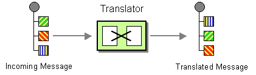

# Unmarshal

The [Marshal](marshal-eip.md) and [Unmarshal](#) EIPs are used for [Message Transformation](message-translator.md).



Camel has support for message transformation using several techniques. One such technique is [Data Formats](../dataformats/index.md), where marshal and unmarshal come from.

So in other words, the [Marshal](marshal-eip.md) and [Unmarshal](#) EIPs are used with [Data Formats](../dataformats/index.md).

-   _Marshal_: Transforms the message body (such as Java object) into a binary or textual format, ready to be wired over the network.
    
-   _Unmarshal_: Transforms data in some binary or textual format (such as received over the network) into a Java object; or some other representation according to the data format being used.
    

## Example

The following example reads JSON files from the inbox/json directory. `unmarshal` turns each file into a Map with [Jackson](../dataformats/jackson2-dataformat.md) (a JSON object becomes a Map, a JSON array a List), so the route can read its fields, such as `${body[orderId]}`:

-   Java
    
-   XML
    
-   YAML
    

```java
from("file:inbox/json")
  .unmarshal().json(JsonLibrary.Jackson)
  .log("Order ${body[orderId]} for customer ${body[customer]}")
  .to("bean:validateOrder");
```

```xml
<route>
  <from uri="file:inbox/json"/>
  <unmarshal><json library="Jackson"/></unmarshal>
  <log message="Order ${body[orderId]} for customer ${body[customer]}"/>
  <to uri="bean:validateOrder"/>
</route>
```

```yaml
- route:
    from:
      uri: file:inbox/json
      steps:
        - unmarshal:
            json:
              library: Jackson
        - log:
            message: "Order ${body[orderId]} for customer ${body[customer]}"
        - to:
            uri: bean:validateOrder
```

The next example reads XML files from the inbox/xml directory. Each file is then transformed into Java Objects using [JAXB](../dataformats/jaxb-dataformat.md). Then a [Bean](../bean-component.md) is invoked that takes in the Java object.

Then the reverse operation happens to transform the Java objects back into XML also via JAXB, but using the `marshal` operation. And finally, the message is routed to a [JMS](../jms-component.md) queue.

-   Java
    
-   XML
    
-   YAML
    

```java
from("file:inbox/xml")
  .unmarshal().jaxb("com.acme.order")
  .to("bean:validateOrder")
  .marshal().jaxb("com.acme.order")
  .to("jms:queue:order");
```

```xml
<route>
  <from uri="file:inbox/xml"/>
  <unmarshal><jaxb contextPath="com.acme.order"/></unmarshal>
  <to uri="bean:validateOrder"/>
  <marshal><jaxb contextPath="com.acme.order"/></marshal>
  <to uri="jms:queue:order"/>
</route>
```

```yaml
- route:
    from:
      uri: file:inbox/xml
      steps:
        - unmarshal:
            jaxb:
              contextPath: com.acme.order
        - to:
            uri: bean:validateOrder
        - marshal:
            jaxb:
              contextPath: com.acme.order
        - to:
            uri: jms:queue:order
```

## Allow Null Body

Sometimes, there are situations where `null` can be a normal value for the body of a message but `null` by default is not an accepted value to unmarshal. To work around that, it is possible to allow `null` as value to a body to unmarshall using the option `allowNullBody` as shown in the next code snippets. A `null` body then skips the unmarshalling and leaves the message as it is, as `marshal` does; with `variableReceive`, that variable is set to `null`.

-   Java
    
-   XML
    
-   YAML
    

```java
from("file:inbox/xml")
  .unmarshal().allowNullBody().jaxb()
  .to("bean:validateOrder");
```

```xml
<route>
    <from uri="file:inbox/xml"/>
    <unmarshal allowNullBody="true">
        <jaxb contextPath="com.acme.model"/>
    </unmarshal>
    <to uri="bean:validateOrder"/>
</route>
```

```yaml
- route:
    from:
      uri: file:inbox/xml
      steps:
        - unmarshal:
            allowNullBody: "true"
            jaxb:
              contextPath: com.acme.order
        - to:
            uri: bean:validateOrder
```